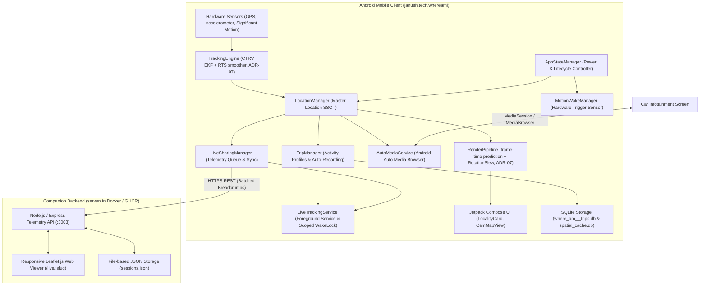

# WhereAmI - Technical Architecture Document (TAD)

This document is the authoritative, comprehensive technical architecture specification for the **WhereAmI** platform (`janush.tech.whereami`). It establishes the system architecture, component boundaries, data flows, core technical decisions (ADRs), code quality rules, and testing requirements.

---

## 1. Executive Summary & Core Mission

### Core Value Proposition (Non-Negotiable)
WhereAmI is designed for **ultra-fast, unambiguous, and reliable real-time spatial awareness** across Android, Android Auto, and companion web viewers:
1. **Primary Locality Display**: Instantly and legibly showing the **current place name** (City, Town, Village, or Settlement) with its complete, unambiguous **structural administrative hierarchy** (Municipality `gm.`, County `pow.`, Voivodeship `woj.`, Country).
2. **Canonical Road / Street Display**: Instantly showing the canonical road designation (`DK52`, `DW946`, `A4`, `S7`, `E77` without house numbers on major corridors, or formatted residential streets `ul. Mickiewicza 12`).
3. **Core Supremacy**: All supplementary features (trip recording, live sharing, heat map overlays, GPX export, statistics) exist to support this primary experience. **Never compromise, regress, or visually obstruct the primary locality and road awareness display.**

---

## 2. High-Level Architecture & Component Map

The platform consists of two principal components: the Android Native Application and the Companion Live Sharing Backend.



---

## 3. Technology Stack & Framework Inventory

| Layer | Technology | Version / Specification | Rationale & Purpose |
| :--- | :--- | :--- | :--- |
| **Language & Toolchain** | Kotlin | `2.0.21` (JVM Toolchain 17) | Modern, expressive, type-safe reactive development. |
| **Build System** | Gradle (KTS) | `8.11.1` (Android Gradle Plugin `8.8.0`) | Configuration-cache compliant, fast modular builds. |
| **Target SDKs** | Android SDK | `minSdk = 26` (Android 8.0), `targetSdk = 36` | Broad device coverage down to Android 8.0; modern Android 15/16/17 compatibility. |
| **UI Framework** | Jetpack Compose | Material 3 + Custom Design Tokens | Declarative reactive UI, custom floating map cards, dynamic aperture optical centering. |
| **Reactive Pipelines** | Kotlin Coroutines & Flow | `StateFlow`, `SharedFlow`, `SharingStarted.WhileSubscribed` | Structured concurrency, reactive UI updates, leak-free subscriptions. |
| **Map Rendering** | OSMDroid | `6.1.20` | Native offline/online OpenStreetMap tile rendering, customizable vector overlays, zero proprietary API fees. |
| **Location Provider** | Google Play Services Location | `21.3.0` (`FusedLocationProviderClient`) | Industry-standard GNSS Doppler velocity and high-accuracy positioning. |
| **Hardware Sensors** | Android Sensor Framework | `TYPE_SIGNIFICANT_MOTION`, `TYPE_ACCELEROMETER` | Hardware-level micro-power motion detection (~0 mW sensor hub sleep). |
| **Local Persistence** | SQLite | `SQLiteOpenHelper` (custom schema migrations) | High-performance, zero-overhead relational storage for trips, points, and spatial LRU cache. |
| **Companion Server** | Node.js / Express | Alpine Linux Docker Container (`ghcr.io`) | Lightweight, self-hostable on Synology NAS / VPS, REST telemetry synchronization. |
| **Web Map Viewer** | Leaflet.js | `1.9.4` | Fast, mobile-responsive, dependency-free browser tracking viewer. |
| **Testing** | JUnit 4, Kotlin Test | Unit test suites in `app/src/test/java/` | Automated unit testing for all kinematic, parsing, filtering, and interpolation logic. |

---

## 4. Core Subsystems Deep Dive

### A. Master Location Pipeline (Single Source of Truth)
All raw location fixes enter through `LocationManager.kt` via `masterLocationFlow`:
- **Fast Snapshot Emission**: Emits immediately upon GPS fix arrival with cached/committed locality metadata to eliminate UI lag.
- **Asynchronous Geocoding Decoupling**: Background geocoding enrichment runs asynchronously in `ioScope`. Crucially, async geocoding completions are **monotonically guarded** (`latestEnrichedTimestamp`) and **never re-emit past coordinates** into the kinematic map pipeline.
- **Flow Separation**:
  - `getLocationUpdates(language)`: Supplies enriched place names and administrative hierarchies for the Locality Card.
  - `getLocationRaw()`: Emits lightweight `LocationFix` instances with `.distinctUntilChanged` on `(lat, lng, timestamp)` strictly for real-time map tracking.

### B. 5-Stage GPS Kinematic Filter Engine (`GpsFilterEngine`) - SUPERSEDED by `TrackingEngine` (ADR-07, v1.11.0)
Raw mobile GPS fixes undergo rigorous validation before being passed to UI, recording, or live streams:
1. **Horizontal Accuracy Gate**: Rejects fixes exceeding profile-specific thresholds (Driving $\le 55\text{m}$, Cycling $\le 55\text{m}$, Hiking $\le 40\text{m}$). Degraded fallback fixes accepted only after 45s of signal starvation.
2. **Kinematic Velocity Gate**: Rejects displacement exceeding profile physical maximums (Driving $> 220\text{ km/h}$, Cycling $> 90\text{ km/h}$, Hiking $> 22\text{ km/h}$) when displacement $> 10\text{m}$ or $\Delta t < 0.8\text{s}$.
3. **Directional Projection Gate (Anti-Backward-Jump Filter)**: Evaluates vector dot product $(D \cdot V) / |D|$ against active heading. If moving forward ($\ge 1.2\text{ m/s}$) and displacement $\ge 8\text{m}$, rejects backward spikes with $\cos \theta < -0.35$ ($> 110^\circ$ reversal).
4. **Consecutive Anomaly Recovery**: Allows instant trajectory change/recovery after 3 consecutive agreeing anomalous fixes (handles emerging from long tunnels, flight landings, or true U-turns).
5. **Stationary Jitter Dampener**: Dampens micro-oscillations when stopped ($< 4\text{m}, < 0.5\text{ m/s}$) without wiping Doppler hardware speed. Profile-aware bearing gate retains frozen heading when moving below reliable heading speed ($0.9\text{ m/s}$ in outdoor modes).

### C. 60fps Dead-Reckoning Position Interpolation (`PositionInterpolator`) - SUPERSEDED by `RenderPipeline` (ADR-07, v1.11.0)
- Runs on the display frame clock (`withFrameNanos`) inside `OsmMapView.kt`.
- Projects position forward along the heading vector using flat-earth trigonometric projection ($v \times \Delta t$), capped at $1.2\text{s}$ with smooth deceleration decay to prevent runaway extrapolation or rubber-banding.
- Uses a $250\text{ms}$ ease-out blending window on new GPS fix arrivals to ensure zero visual jumping or snapping.
- Stationary dampening: locks position when velocity $< 0.35\text{ m/s}$ and throttles redraw to $350\text{ms}$ to save battery.

### D. Multi-Tier Geocoding, Road Snapping & Boundary Integrity
- **Precedence Hierarchy**: `OSRM Snapped Road` $\to$ `OSM Nominatim Vector Road` $\to$ `Android Platform Geocoder`.
- **High-Speed Corridor Inertia**: At speeds $> 35\text{ km/h}$ on major roads (`DK*`, `DW*`, `A*`, `S*`), requires at least 5 consecutive confirmations and $\ge 7.0\text{s}$ of sustained fixes before switching to a cross-street.
- **15-Second Decay Grace Period**: Preserves confirmed street identity for 15 seconds during temporary tunnel or signal cutouts; never blanks out or flickers.
- **Intentional Locality Visit Filter**: Commits a town/locality to trip history ONLY if the user penetrates $\ge 150\text{m}$ into the locality OR remains within it for $\ge 45\text{s}$. Skimming along border highways does not trigger false visits.
- **Spatial LRU Cache**: 4-decimal grid resolution (~11m cell resolution) in SQLite (`where_am_i_spatial_cache.db`) with strict 30-minute freshness TTL.

### E. Battery, Power Lifecycle & Sleep Architecture
Battery optimization is the highest engineering priority:
- **`AppStateManager` Lifecycle States**:
  - `IDLE`: Screen off, no active trip, no live sharing. **GPS hardware is completely powered down** (`LocationManager.stopLocationUpdates()`).
  - `FOREGROUND_VIEW`: Interactive map open (1500ms sampling; 3000ms on Battery Saver).
  - `TRIP_RECORDING`: Active trip in progress (profile-specific high-fidelity sampling: Car/MTB/Cycling/Running 2000ms base / 1000ms min; Hiking/Walking 3000ms base / 1500ms min).
  - `LIVE_ONLY`: Live sharing active without local trip (12s on battery, 6s when charging).
  - `ANDROID_AUTO`: Infotainment screen active (3000ms / 1000ms).
- **Zero-Power Motion Wake (`MotionWakeManager`)**:
  - In `IDLE` state with `TripMode.AUTO`, arms Android's hardware `Sensor.TYPE_SIGNIFICANT_MOTION` trigger sensor.
  - The hardware sensor hub monitors motion while the main CPU and GNSS chip remain in deep sleep (~0 mW draw).
  - When locomotion occurs, triggers a temporary, activity-profile-adapted confirmation GPS burst (`(profile.autoStartDurationMs + 20_000L).coerceAtLeast(35_000L)`).
  - If speed criteria are sustained, the trip auto-starts. If motion was transient, GPS powers down and the sensor re-arms.
- **Scoped Wake Locks**:
  - `LiveTrackingService` acquires a `PARTIAL_WAKE_LOCK` strictly when a trip or live sharing session is active.
  - In standby or when stopped, wake locks are **immediately released**. No zombie wake locks are ever permitted.
- **Screen-Off MANUAL Mode**:
  - In `TripMode.MANUAL`, when screen is off with no active trip or live sharing, GPS and foreground services are completely stopped (Option A).

---

## 5. Architectural Decision Records (ADRs)

### ADR-01: SSOT Kinematic Decoupling from Asynchronous Geocoding
- **Context**: In field testing (2026-09-25), the map heading icon was jumping back and forth and snapping to 0 km/h. Diagnostics revealed `enrichedSnapshot` in `LocationManager.kt` was re-emitting past coordinates from asynchronous network closures (1-3s prior) back into the kinematic pipeline.
- **Decision**: Decouple kinematics from geocoding. `enrichedSnapshot` now strictly adopts current kinematics from `currentSnap`. `getLocationRaw()` outputs monotonic `LocationFix` instances filtered by `.distinctUntilChanged` on coordinates and timestamps. Geocoding completions never re-trigger map repositioning.
- **Consequences**: Zero teleportation, zero heading jitter, complete preservation of geocoding richness without visual side-effects.

### ADR-02: 60fps Dead-Reckoning Position Interpolation
- **Context**: Map repositioning previously executed discrete `animateTo(centerGp, 400L)` calls on every raw GPS fix (~1.5s). Each new fix aborted previous animations mid-flight, creating noticeable jerky stuttering.
- **Decision**: Implemented `PositionInterpolator.kt` running on the display frame clock (`withFrameNanos`). Forward-projects coordinates along heading vector using velocity and $\Delta t$, blended with a 250ms ease-out filter upon new fix arrival. Map center is updated directly with `setCenter(centerGp)` on display VSYNC.
- **Consequences**: Perfectly smooth 60fps movement across all speeds; map camera glides without interruption.

### ADR-03: Zero-Power Hardware Motion Wake & Scoped Wake Locks
- **Context**: Battery profiling revealed 3.89 mAh overnight drain (~58% of application layer draw, GNSS active 4m18s, wake lock held 7m17s) caused by a zombie foreground service and continuous GPS polling in AUTO mode.
- **Decision**:
  1. Fixed zombie service leak in `TripManager.stopTrip()`.
  2. Built `MotionWakeManager` using `Sensor.TYPE_SIGNIFICANT_MOTION` with `TriggerEventListener` (~0 mW sensor hub operation).
  3. In `IDLE`, GPS is powered down completely; locomotion wakes a 35s confirmation burst.
  4. `LiveTrackingService` wake locks are strictly scoped to active trips/sharing and released immediately in standby.
- **Consequences**: Overnight standby drain eliminated (~0 mAh when stationary); automatic trip detection preserved.

### ADR-04: Circular EMA Bearing Smoothing & Speed-Adaptive Tiered Gates
- **Context**: Low-speed driving ($\le 10\text{ km/h}$) produced $\pm 35^\circ$ bearing jitter, causing the map to spin 360° and the cursor arrow to wobble across the street.
- **Decision**: Implemented circular exponential moving average (`smoothBearing`) using vector $\sin/\cos$ decomposition to eliminate $0^\circ/360^\circ$ wraparound spikes. Governed by speed-adaptive $\alpha$ ($0.15 \to 0.80$) and tiered minimum speed gates ($3.0\text{ m/s} \to 8.0\text{ m/s}$ based on GPS accuracy).
- **Consequences**: Completely stable heading orientation at traffic lights and low-speed residential navigation.

### ADR-05: OSM & OSRM Vector Precedence over Platform Geocoder
- **Context**: Android Google Geocoder frequently returned obsolete rural cadastral hamlet names (e.g. `Krzemionki 8`) instead of the true road the vehicle was on (`Wincentego Witosa 14`).
- **Decision**: Inverted street resolution priority: `OSRM Snapped Road` $\to$ `OSM Nominatim Vector Road` $\to$ `Android Platform Geocoder`.
- **Consequences**: Street display strictly aligns with OpenStreetMap vector cartography and official Polish road numbers.

### ADR-06: 4-Decimal SQLite Spatial LRU Cache with Strict 30-Minute Expiry
- **Context**: A coarse spatial cache key (~111m) returned stale street names on sharp turns, and indefinite caching locked in temporary geocoding errors across sessions.
- **Decision**: Refined spatial cache resolution to 4 decimal places (~11m x ~7m cell resolution) in SQLite. Enforced strict 30-minute expiry (`maxAgeMs = 30 * 60 * 1000L`) during online operation, reserving indefinite fallback strictly for offline scenarios.
- **Consequences**: Instant turn recognition with offline resilience and protection against permanent stale data corruption.

### ADR-07: Tracking Engine v2 (EKF + Fixed-Lag Smoother + Frame-Time Render Pipeline)
- **Context**: Field recordings (2026-10-19) showed stepped map rotation that corrected back, a cursor lagging the real position, a straight chord from the pre-screen-off point and an angular polyline. Root causes: (1) `PositionInterpolator` buffered 1 s (shorter than fix interval plus delivery latency) and alternated between spline tangent and lagged raw bearing; (2) rotation `dt` mixed `currentTimeMillis` and `uptimeMillis` (always clamped), and the frame loop captured a stale fix; (3) `PositionStabilizer` was a position-only random-walk Kalman (cuts corners, lags); (4) only the last location of each `LocationResult` batch was processed; (5) the live polyline and the persisted geometry were two different data paths; (6) per-fix `points_json` rewrite and a 23392-code-unit `LocationScreen` (above the ART compile limit, so it ran interpreted).
- **Decision**: One estimator feeds recording, display and live sharing, on one monotonic clock (`elapsedRealtimeNanos`).
  - `tracking/TrackingEngine` + `KinematicEkf`: CTRV state `[E, N, v, heading, yawRate]` in a local ENU frame with innovation gating (chi-square), implied-speed cap, consistent-rejection reset, ZUPT/Doppler/course/gyro measurements, stationary mode and stationary anchoring (no multipath creep).
  - `FixedLagSmoother` (RTS, 3 s lag): its emitted points are the recorded geometry and distance; `provisional()` gives the live tail. Latency exists only while the filter needs more data.
  - `RenderPipeline`: predicts to frame time along the CTRV arc, blends corrections critically damped, adaptive 0-1800 ms latency, heading held when not confident, counter-rotation correction absorbed slowly. `RotationSlew` drives course-up rotation (acceleration/rate limited, profile aware).
  - Storage: `track_points` table (WITHOUT ROWID, PK `(trip_id, seq)`) with per-point time, speed, accuracy, bearing, flags; idempotent per-trip backfill from legacy `points_json` (left untouched). Batched writes on a single writer thread; blocking final write at stop.
  - Live polyline = committed smoothed points + provisional tail + cursor tip (single source, rebuilt on resume).
  - GNSS: all `LocationResult.locations` processed in order; `GRANULARITY_FINE`; screen-off recording batches fixes (`setMaxUpdateDelayMillis` 20 s, 30 s in battery saver) while car/cycling keep 1 Hz so turns are not chorded; identical `LocationRequest` re-issues are deduplicated. Gyro yaw rate (`GyroHeadingSensor`) is registered only when the app is in the foreground, moving and following/recording (`GyroPolicy`).
  - Post-trip OSRM `/match` (CAR, online, not while recording) stores an alternate geometry in `trip_matches`; the recorded track stays authoritative. A chunk is accepted only if confidence >= 0.5 and >= 90% of raw points lie within 45 m of the snapped line.
  - `LocationScreen` blocks are lifted into local composables (23392 -> 8178 code units).
- **Consequences**: Smooth, corner-faithful geometry with bounded latency; fewer CPU wakeups when the screen is off; richer stored data (GPX now carries `<ele>`/`<time>`). Trade-offs: screen-off 1 Hz for car/cycling raises GNSS duty versus the old 5-6 s cadence (offset by batching, user can pick battery saver); `track_points` doubles trip storage per point; OSRM matching depends on a public demo server (rate-limited, shared mutex). `AGENTS.md` invariants (no wake locks in LIVE_ONLY/standby, GPS off in IDLE, 60/30 s LIVE_ONLY stationary cadence) are unchanged.
- **Amendment (v1.12.0, walking field test 2026-10-19)**:
  - Live polyline = committed smoothed points + **pencil trail** (`tracking/PencilTrail`: the cursor's own rendered path since the newest committed vertex) + cursor tip. The re-estimated RTS tail was dropped from the display because it re-shaped on every fix ahead of and behind the cursor.
  - Recorded vertices are chosen by `tracking/AdaptiveTrackSampler`: online opening-window simplification with a speed-scaled tolerance (0.25 m + 0.06 s x v), min spacing 0.5 s x v (>= 0.8 m) and max spacing 2 s x v (2-60 m), plus a 30 s time cap. Density follows measured speed, not the selected profile.
  - `TrackingEngine.activeProfile`: the selected profile is a prior; sustained Doppler speed above 85% of its top speed escalates to the next kinematic envelope (WALKING -> HIKING -> RUNNING -> MTB -> CYCLING -> CAR) and it relaxes back after 60 s of matching motion, so a mislabelled activity does not trigger reject/reset cycles.
  - A parked device with sparse fixes continues its stationary state across gaps longer than 8 s instead of re-seeding (re-seeding jumped the anchor and broke rest-stop dwell clustering). Course measurement low-speed inflation is relative to the profile's heading-observability speed (`COURSE_LOW_SPEED_INFLATION`).
  - Heading arrow: the filter heading while it is observed (`Pose.headingFresh`); otherwise, while visibly moving, the direction of the cursor's rendered motion (`tracking/MotionCourse`). Without an observed heading the render pipeline continues the last displacement instead of dead-reckoning along a random-walk heading.
  - Altitude badge: one position writer (the frame loop); DEM value held within 150 m of where it was resolved (`DemAltitudeHold`); cache and network lookups run off the main thread.
- **Amendment (v1.13.0, weak-GPS walking recording 2026-10-19)**:
  - *Context*: at ~1 m/s with 7-13 m accuracy, GNSS noise between fixes exceeds the distance walked. Predicting along the Doppler course and then blending each correction (0.4 s spring) pulled the cursor sideways after every fix: the pencil drew triangles and squares and the arrow (Doppler heading) pointed off the line. Replay of trip 230: arrow vs. drawn line p90 63 deg, arrow vs. smoothed course p90 62 deg.
  - *Slow on-foot render mode* (`RenderPipeline`, profiles with top speed <= 10 m/s, filtered speed < 2.2 m/s on / > 2.8 m/s off): the cursor runs 1.6 s behind (latency slew 250 ms/s on foot) on a time-parametrised Catmull-Rom curve through the filtered positions, with tangents from neighbouring positions, not the Doppler course. Beyond the newest state it continues the last displacement. `Pose.pathHeadingDeg` is the direction of that curve plus the correction velocity being blended in, i.e. where the cursor visibly goes; the arrow and course-up use it first. Vehicles never enter this mode (pulling away from a stop would start tens of metres behind).
  - *Display curve* (`tracking/CurvedPolyline`, `LiveTrackLine`): the drawn trip polyline is a centripetal Catmull-Rom spline through the recorded vertices (0.6 m steps, up to 8 per segment, straight segments untouched). Display only: stored vertices, distance and GPX are unchanged and every vertex stays on the line. Segment j depends on vertices j-1..j+2, so the committed part is densified incrementally and only the last committed segment and the pencil are re-curved. The segment to the cursor tip stays straight.
  - *Shape change on commit* (pencil replaced by smoothed vertices) is kept: the smoother uses 3 s of later fixes and is what is stored. The slow mode halves its size (trip 230 p90 0.92 -> 0.37 m).
  - Evidence (`LiveRenderSim` in `FieldReplayTest`, 300 ms delivery delay), trip 230 legacy -> new: arrow vs. last 1 m of drawn line p90 63 -> 36 deg, arrow vs. smoothed course p50/p90 24/62 -> 13/35 deg, drawn-vertex turn p90 91 -> 24 deg. Trip 229 (good GPS): arrow vs. course p90 29 -> 21 deg, vertex turn p90 68 -> 16 deg. CAR replay: arrow unchanged.
- **Amendment (v1.14.0, screen recording of build 107, 2026-10-19)**:
  - *Join blend* (`PencilTrail.blendedFrom`): the pencil start is shifted by (newest committed vertex minus the pencil position at that time) and the shift fades to zero over 4 m (never beyond the cursor tip), so the line leaves the committed vertex without the hook behind the cursor. The line still ends under the cursor. Tail-kink p90 (direction change in the last 3 m): trip 231 156 -> 86 deg, 230 128 -> 81, 229 177 -> 75.
  - *Compass arrow* (on-foot profiles only, setting `pref_compass_arrow`, default on): rotation-vector sensor -> device-to-ENU matrix -> facing direction (flat: Y axis, upright: -Z, blended by tilt) + `GeomagneticField` declination (`CompassMath`, `CompassTracker`). The compass is sampled at `pose.renderTimeMs` so the arrow agrees with the drawn line (cursor runs ~1.6 s behind). `CompassArrow` learns the circular-mean offset between the course and the compass while moving (tau 6 s) and is trusted only with resultant >= 0.70 after 3 s of moving samples and while a fast average (tau 1.5 s) stays within 40 deg of the slow one (a swung phone drops trust within seconds). Not trusted or at rest: course as before. Never used at rest (no spinning). `CompassPolicy` gates the sensor like `GyroPolicy` (setting, on foot, foreground, moving, following or recording). Diagnostics field `cp` records the compass heading for replay.
  - *Unverified*: compass benefit has no field data yet; needs a walk with build 108 (`cp` in the JSONL).
- **Amendment (v1.15.0, driving screen recordings of build 108, 2026-10-19)**:
  - *CTRA*: the EKF state gains longitudinal acceleration (`[east, north, speed, heading, yawRate, accel]`) as a Singer process (`TrackingProfile.accelTauS`: CAR 2.5 s, CYCLING 2.0, MTB 1.5, on foot 2.5). ZUPT pins it to zero and decorrelates it (an accel update with tiny R collapsed the position variance). A constant-speed model ran ahead while braking and crept back at the stop.
  - *Stop entry*: when the engine enters stationary, 0.5 sigma^2 is added to the position variance (and to the stored prediction covariance, keeping RTS consistent) so the stop converges to the mean of its fixes before the 10 s anchor.
  - *Course consistency* (`CourseConsistency`): over 8 s, the fix displacement versus the displacement predicted by the reported bearings and Doppler speeds (trapezoid). Only straight windows (bearings within 25 deg), minus atan(accuracy / baseline), the smallest of 3 consecutive values; the course sigma is at least 2x that. Catches a provider bearing that is biased while claiming high accuracy.
  - *Vehicle latency*: vehicles render 1.0 s behind (`RenderPipeline.VEHICLE_LATENCY_MS`, floor of the adaptive latency; since v1.16.0 kept through data gaps), so the cursor moves between filter states instead of extrapolating and correcting. Re-shape of the drawn line p90 2.9 -> 1.6 m. The map follows the cursor, so line and map stay consistent; the cursor is ~14 m behind the vehicle at 50 km/h.
  - *Vehicle arrow guard* (`MotionCourse.forVehicle`): when the filter heading is not fresh, a vehicle keeps the last heading if the visible motion is more than 90 deg from it within 8 s (the cursor sliding onto a stop is not a U-turn).
  - *Not addressed*: residual GNSS offset at steady speed (filter vs. own fixes ~1 m p50) puts the line on curbs or the opposite lane; that needs live map matching (backlog).
- **Amendment (v1.16.0, driving screen recordings of build 114, 2026-10-20)**:
  - *Batched fixes are flushed* (`BatchedRequestSequencer` in `LocationManager`): changing or removing a request with `maxUpdateDelayMillis` discards the pending batch, so `flushLocations()` runs first and the change is applied when it completes (latest change wins). Every screen-on had lost 10-17 s of driving and stored a chord.
  - *Every state reaches the renderer*: `LocationManager` appends each accepted `TrackState` to `TrackingRuntime.states` (`TrackStateLog`); the map frame loop feeds all states newer than the last one consumed. The conflated Compose fix delivered only the last state of a batch.
  - *Pencil refill*: after missed frames (screen off) or a batch of >= 3 states, pencil points after the previously known state are dropped and the pencil is refilled from `RenderPipeline.pathBetween` (interpolated history, never extrapolated), so the live line never chords to the cursor.
  - *Gaps*: vehicles keep the 1.0 s latency when fixes stop (on foot still drops to 0). Prediction integrates braking from the filter's Singer acceleration (`TrackState.accelMps2`) and stops at zero; acceleration is not extrapolated.
- **Amendment (v1.16.1, walking screen recordings of build 115, 2026-10-20)**:
  - *Course-up vs arrow*: map rotation uses `CourseUpHeading` (confident filter heading, else motion course). The compass and slow-mode path tangent may still drive the arrow only. Walking `RotationSlew` hysteresis is 3 deg (was 0.8) with a lower rate so sidewalk heading noise does not wave the map.
  - *Pencil*: minimum step floor 1.0 m; Catmull-Rom densify applies to committed vertices only (pencil stays piecewise-linear) so multipath scribbles are not amplified into coils that the smoother later erases.

---
- **Amendment (v1.18.11, overnight Live GPS + late auto-start, 2026-10-22)**:
  - *LIVE_ONLY*: screen-off stops GPS entirely (charging or battery); presence via HTTP heartbeat (≥5 min screen-off, 60 min in Sleep).
  - *Auto-sleep*: morning alarm wakes only within 5 min of bedtime end; pause-live-on-sleep defaults to true (one-time migrate).
  - *Vehicle auto-start*: confirmation capped at 15 s (migrates leftover 30 s prefs).
- **Amendment (v1.18.6, cycling tip spikes trip 244, 2026-10-21)**:
  - *TrackSpikeGuard*: rejects large gap teleports where displacement ≪ Doppler travel, and three-point course reversals (≥135° / ≥25 m / ≥5 s). `MIN_JUMP_M` lowered to 45 m for slow/impossible tips.
- **Amendment (v1.18.2, bare DK52 + late auto-start, 2026-10-21)**:
  - *Corridor name*: when committed display is a bare highway code and the spatial-cache cell has a local name without a house number, coalesce to `Krakowska (DK52)`. Viaduct shield only rejects residential addresses (house number). On open, purge bare `DK*`/`DW*`/`A*`/`S*` cache rows and dedupe doubled `(DK52) (DK52)` annotations.
  - *Vehicle auto-start*: softer gate (`35 m` accuracy, one forgiven miss, window starts at 70% of target speed); CAR displacement floor 25 m. Foot auto-start stays strict. User-configured duration still applies (`pref_auto_start_sec_*`).
- **Amendment (v1.17.12, discarded walk trip 241, 2026-10-21)**:
  - *Scribble discard*: restricted to vehicle profiles; requires path/cluster ≥ 12 and path ≥ 200 m. Foot out-and-back trips are kept.
- **Amendment (v1.17.8, indoor auto-start + SK cache, 2026-10-21)**:
  - *Auto-start*: uses `ResumeMotionGate` (accuracy + sustained speed + real displacement); removed 25 m / 8 s shortcut.
  - *Scribble discard*: vehicle auto trips with nest geometry (`TripScribble`) deleted on stop (superseded for foot profiles in v1.17.12).
  - *SK highways*: `sanitizeStreetForCountry` + spatial-cache migration of Polish `DK*`/`DW*` → `I/`/`II/`.
  - *Parking crawl*: `AdaptiveTrackSampler` holds vertices below 1.0 m/s until 12 m escape; vehicle pencil floor 3 m.
- **Amendment (v1.17.7, driving field round 2026-10-21)**:
  - *Named street over bare highway code*: when OSRM `/nearest` returns only `DW948`/`DK52` but OSM/Geocoder has a local name, coalesce to `Krakowska (DW948)` (`RoadNameNormalizer.coalesceOsrmAndOsmStreet`).
  - *Spatial cache write protect*: never overwrite a named street cell with a bare highway code; persist `road_ref` when known.
- **Amendment (v1.17.1, driving vs Wikiloc/Komoot/hiking maps, 2026-10-20)**:
  - *Display road snap*: OSRM `/nearest` already used for street names now also returns snapped coordinates; `DisplayRoadSnap` applies a bounded EMA offset (max 18 m) to the live cursor and polyline only (recorded `track_points` unchanged).
  - *Resume catch-up*: after missed frames or a batch, the pencil is cleared from the committed vertex and refilled from `pathBetween` (no hieroglyph chords).
  - *Street card*: `RoadNameNormalizer.formatStreetDisplay` so "Krakowska" + ref `52` shows as `Krakowska (DK52)`, never `Krakowska • 52`.

## 6. Code Quality, Testing Gates & Coverage Requirements

### Mandatory Unit Testing Policy
- **Every algorithmic rule, mathematical filter, data transformation, parser, or state machine MUST have automated unit tests in `app/src/test/java/`**.
- Tests must execute in the local JVM without requiring an attached Android device or emulator.
- Existing Test Suites:
  - `tracking/TrackingEngineTest.kt`, `RenderPipelineTest.kt`, `SupportingTrackingTest.kt`: Replay-harness tests for the EKF/smoother (stationary drift, heading reversal, outlier gating, recovery) and frame-time render pipeline (ADR-07).
  - `tracking/GyroHeadingSensorTest.kt`, `RouteMatchingTest.kt`, `TrackPointRowTest.kt`, `GpxExporterTest.kt`, `LocationRequestCadenceTest.kt`: Gyro register/unregister lifecycle, OSRM match chunking/acceptance, `track_points` rebind and legacy conversion, GPX `<ele>`/`<time>`, batching constants.
  - `BatteryOptimizationAndAutoStartTest.kt`: Validates all activity profile auto-start thresholds, candidate evaluation, burst durations, and lifecycle semantics.
  - `BearingSmootherTest.kt`: Validates circular EMA smoothing, $\sin/\cos$ angular difference math, speed-adaptive $\alpha$, and tiered bearing gates.
  - `RoadNameNormalizerTest.kt`: Validates canonical abbreviations (`DK*`, `DW*`, `A*`, `S*`, `E*`) and house number filtering.
  - `TripSplitTest.kt`: Validates pause splitting, trip merging, and pause deletion.
  - `HierarchyResolutionTest.kt`: Validates administrative hierarchy formatting and deduplication.
  - `BoundaryRankingTest.kt`: Validates Nominatim boundary polygon ranking heuristics.
  - `SpatialCacheGridTest.kt`: Validates 4-decimal spatial grid key quantization and freshness TTL.
  - `StationaryDetectorTest.kt`: Validates accelerometer variance calculation for surface stability detection.

### Pre-Completion Build Gates (Strict Enforcement)
Before committing or reporting any feature or bug fix as complete, the agent MUST run:
```bash
# macOS / Linux:
./gradlew testDebugUnitTest assembleDebug

# Windows:
.\gradlew.bat testDebugUnitTest assembleDebug
```
Both commands must finish with `BUILD SUCCESSFUL` (0 test failures, 0 compilation errors).

---

## 7. Governance, Operational Rules & Git Lifecycle

- **No Direct Pushes or Local Merges to `master` (Pull Request Only)**: All development occurs on dedicated feature branches (`feat/<name>`) or bugfix branches (`fix/<name>`). Every change reaches `master` only through a GitHub Pull Request with a green `Unit Tests & Build Verification` check.
- **Feature Branch Lifecycle**:
  1. `git checkout master && git pull origin master`
  2. `git checkout -b <type>/<descriptive-name>`
  3. Implement code, write unit tests, run build gates (`testDebugUnitTest assembleDebug`).
  4. Commit with conventional commit messages (`feat: ...`, `fix: ...`, `docs: ...`).
  5. Push the branch **only upon explicit user instruction**, open a PR into `master` (`gh pr create`), wait for CI, and merge via the PR (`gh pr merge --merge --delete-branch`). Never `git merge` into `master` locally or push `master` directly.
- **Deployment Safeguards**:
  - Never push to GitHub without explicit user approval.
  - Never install APKs to the user's phone without explicit user approval.
- **Documentation Maintenance**:
  - Update `docs/ENHANCEMENT_TRACKER.md` after completing each milestone or phase.
  - Keep `docs/FEATURES_INVENTORY.md` updated as features evolve or retire.
  - Keep this `docs/ARCHITECTURE.md` updated when major architectural decisions are made.

---

## 8. Key Architectural Decision Records (ADRs)

### ADR-01: GNSS Doppler Speed Decoupling in `GpsFilterEngine` (historical; the rule now lives in `TrackingEngine`, which never zeroes Doppler speed)
- **Context**: In Stage 4 (Stationary Jitter Dampener), low-displacement fixes (< 15m) with moderate accuracy (> 15m) previously zeroed `candidate.speed`. During slow urban driving, turns, and roundabouts, 1-second and 5-second displacement frequently falls below 15m while urban multi-path accuracy is 16–25m. This erased valid GNSS Doppler speed, corrupting downstream Kalman filter state and causing speedometer displays of `0.0 km/h` while driving.
- **Decision**: GpsFilterEngine must **NEVER mutate or zero `candidate.speed`**. Hardware GNSS Doppler velocity is physically decoupled from spatial multi-path jitter. Stage 4 only dampens coordinates (`candidate.latitude = prev.latitude`) when displacement is micro (< 4.0m) and speed already confirms stationary (< 0.5 m/s). Speed zero-snapping belongs strictly to `LocationManager.hybridSpeedUpdate()`.

### ADR-02: Universal Screen-Relative Heading Angle in `OsmMapView`
- **Context**: In Osmdroid, `Marker.isFlat = false` renders markers on a canvas that is pre-rotated by `+map.mapOrientation`, applying an internal rotation of `-map.mapOrientation - m.rotation`. Setting `m.rotation = 0` in `COURSE_UP` caused the heading arrow to point straight up even when the map had not finished animating or during sharp turns, twisting the arrow relative to the road track on the map.
- **Decision**: The arrow angle on screen relative to screen top is universally computed as:
  $$\text{roadScreenAngle} = (\text{effectiveBearing} + \text{mapOrientation} + 360^\circ) \bmod 360^\circ$$
  Setting `m.rotation = -roadScreenAngle` guarantees the arrow points strictly along the road on the display across all modes (`COURSE_UP`, `NORTH_UP`, manual gesture rotation, and during active orientation animations).

### ADR-03: Merged Trips Temporal & Spatial Continuity
- **Context**: Merging trips previously concatenated points and visited places without adjusting time gaps or entry distances, resulting in non-monotonic place distances (resetting to 0 km for sub-trips) and 0 rest stops recorded in `pauses_json`.
- **Decision**: `TripDatabaseHelper.mergeTrips()` synthesizes a `TripPause` for any inter-trip gap $\ge 10\text{s}$ at the junction coordinates, shifts existing sub-trip pauses by the cumulative point offset, and offsets each visited place's `distanceAtEntryMeters` by the cumulative distance of all preceding sub-trips, ensuring strictly monotonic distance progression from the merged origin.

### ADR-04: Street Display & House Number Decoupling
- **Context**: Reverse geocoded house numbers appeared intermittently depending on whether Nominatim had an explicit address node or Google Geocoder returned a parcel number, creating visual clutter and inconsistency during navigation.
- **Decision**: House numbers are stripped completely from the primary street awareness display in `RoadNameNormalizer.kt` and `LocationManager.kt`. Street display focuses strictly on canonical street/road name identity. Detailed house number positioning is deferred to a dedicated, on-demand "Nearest Known Address" lookup feature (BKL-07).

### ADR-05: 60s Minimum Motion Burst Confirmation Window
- **Context**: On Android 17 devices in deep Doze, cold GPS Time-To-First-Fix (TTFF) can require 20–45 seconds. A 35-second motion burst window occasionally expired before a valid fix was acquired, preventing auto-start from triggering when leaving from home after overnight rest.
- **Decision**: Motion burst confirmation is extended to at least 60 seconds (`coerceAtLeast(60_000L)`). At burst start, `GpsFilterEngine.reset()` clears overnight static anchors, and an active raw location stream collector is maintained for the duration of the burst to prevent subscriber flow timeout.

### ADR-06: 150s Stationary Dwell & 12m Spatial Cluster Pause Gating
- **Context**: On slow hiking trails (e.g. climbing Kriváň in Slovakia), brief 30–60 second pauses for photo-taking or catching breath frequently triggered false rest stops, producing up to 48 phantom 1-minute pauses on a single trek.
- **Decision**: In `TripManager.kt`, rest-stop creation enforces a 150-second (2.5 min) stationary dwell threshold anchored within a 12-meter spatial cluster gate (`distFromAnchor <= 12.0m`). Resumed motion requires a 45-second debounce window before finalizing the pause. Adjacent pauses within 30m and 60s are coalesced automatically to preserve true prolonged rest periods.

### ADR-07: Invariant Active Trip Visual Isolation
- **Context**: Stopping one activity profile (e.g. Hiking) and starting a new profile (e.g. Driving) caused the map UI and web live share to draw both the active track and previously recorded track together, creating confusion and showing merged routes.
- **Decision**: The active recording state is an absolute boundary. In `OsmMapView.kt`, when `isRecording || trackPoints.isNotEmpty()`, historical polylines (`selectedTripPolylines`) and historical pauses are strictly suppressed from the render tree. In `MainViewModel.kt`, starting an active trip unconditionally clears `_selectedTripIds`. On the backend, starting a new trip invokes `/api/sessions/:id/reset-trail`, which archives past tracks into `pastSegments` and ensures the live broadcast only streams the active journey by default.


